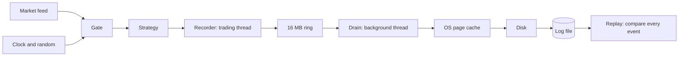

# Flight Recorder

A black box for a trading program. It records every input, replays a run exactly, and proves that the replay matched.

If a program makes a strange trade at 10:32 on Tuesday, you can't normally see that moment again, because prices and the clock have moved on. With a recording, you can run the same program through the same day and stop at the exact event.

**Status:** the first working version. Recording, replay, crash handling and live market data all work, with a toy strategy. Forking a recorded day isn't built yet.

## Results at a glance

| Kill test | Limit | Result | Data |
| --- | --- | --- | --- |
| **Fast:** added cost per event at p99 | Under 1 µs | 83 ns | Synthetic, 20M events a round |
| **Fast:** added cost per event at p99.9 | Under 1 µs | 167 ns | Synthetic, 20M events a round |
| **Exact:** replay matches bit for bit | Every event | 14,750 of 14,750, twice | Real BTC/USDT trades |

All speed numbers come from an Apple M3 Pro laptop. The timer ticks about every 42 ns, so small results are coarse.

## How it works



1. Everything from outside reaches the strategy through one `Gate`, so every input can be saved.
2. After each event, the recorder takes a fingerprint of the output and state, and builds one record.
3. The record goes into a ring buffer. The trading thread never touches the disk.
4. A background thread writes records out, and forces them onto the disk every 100 ms.
5. Replay runs a fresh strategy from the log alone, with no feed, real clock or real random numbers. It checks every event and stops at the first one that differs.

### The log format

```
[magic "FRLOG01"]
[length][tick][input count][inputs ...][event hash][crc]    one record per event
...
[end marker 0xFFFFFFFF]
```

| Field | Size | Why it's there |
| --- | --- | --- |
| Magic | 8 bytes | Proves this file is one of our logs |
| Length | 4 bytes | Lets replay find where a record ends, or see that it was cut off |
| Tick | 24 bytes | Sequence, price and quantity, because replay has no feed |
| Input count | 4 bytes | Catches a strategy that read too few inputs |
| Inputs | 8 bytes each | The exact clock and random values handed out |
| Event hash | 8 bytes | The fingerprint replay compares against |
| CRC | 4 bytes | Catches damaged bytes |
| End marker | 4 bytes | The only proof that the run finished |

A normal record is 60 bytes.

### What replay can report

| Status | Meaning |
| --- | --- |
| `Match` | The log is complete and every event matched |
| `Diverged` | An event differed, and the report names the first one |
| `TornTail` | Every readable event matched, but the log just stops |
| `Corrupt` | Every event before the damage matched, then bytes failed their checksum |

### What each failure can lose

| Failure | Lost | Kept |
| --- | --- | --- |
| Program crash | Whatever is still in the ring | Everything before it replays |
| Power cut | About the last 100 ms, by design | Everything before it replays |
| Damaged bytes | Everything from the damage onwards | Everything before it replays, and the damage is reported |

## Quick start

You need `clang++`, `make` and Python 3.

```bash
make check        # every test, on both ring sizes, plus disk failure and checksum checks
make bench        # speed test, 1M events a round, prints PASS or FAIL
make bench-long   # speed test, 20M events a round, writes about 1.2 GB a round
```

Record real trades and replay them. The feed only listens: no account, no key, no orders.

```bash
make build/fr_tool
python3 tools/live_feed.py --symbol btcusdt --seconds 60 | build/fr_tool record-stdin clean run.log
build/fr_tool replay clean run.log 0
```

## Repository layout

| Path | What it does |
| --- | --- |
| `include/fr/flight_recorder.h` | The contract: `Tick`, `Gate`, `Strategy`, `record_run`, `replay_run` |
| `src/flight_recorder.cpp` | The engine: ring, background writer, checksums, disk syncs, replay |
| `tools/live_feed.py` | Streams public Binance trades, using only Python's standard library |
| `tests/feed.h` | Synthetic feed, and a reader for streamed trades |
| `tests/strategies.h` | The toy strategy, planted leaks and a crash |
| `tests/fr_tool.cpp` | Runs one record or replay as its own process |
| `tests/run_tests.cpp` | The 21 black-box tests |
| `tests/bench_record.cpp` | The speed test |

## Decisions

### Project direction

| Decision | Why |
| --- | --- |
| Focus on proving a replay matched | Aeron Archive already records and replays streams, and NautilusTrader already has a single-threaded core and writes live runs to files. Neither's docs describe proving a live replay matched bit for bit, or finding the first event that differed. This came from reading docs only, not their source. |
| Set two kill tests up front | A project this size needs a clear way to fail. Fast and exact are the two things a black box can't do without. |
| Start with a tiny slice | The riskiest idea was catching every hidden input, so we tested that with a toy before building anything bigger. |
| Predict before each experiment | The gap between a prediction and a result shows what was misunderstood. |
| Find the cause before fixing a problem | We measured how often the slow events happened before building a fix, so we wouldn't fix the wrong thing. |

### Replay

| Decision | Why |
| --- | --- |
| One `Gate` for all outside inputs | Anything that skips the door can't be recorded, and replay would silently drift. |
| Hash the output and the state for each event | State can differ before any output shows it. |
| Compare after every event | This names the exact first difference, not just that something changed. |
| Count gate reads per event | A strategy can read too few or too many inputs and still produce the same output. |
| Record and replay in separate processes | Some leaks can't appear within one process. Map order based on memory addresses can repeat there. |

### Log format

| Decision | Why |
| --- | --- |
| Length-prefixed records | Records vary in size, so each must say where it ends. |
| An end marker | A log cut exactly between two records looks whole. A start marker can't solve this, because nothing follows the last run. |
| Treat a log as torn until END proves otherwise | Every way of running out of log gives the safe answer without extra code. |
| Prices as whole numbers, scaled by 100,000,000 | Decimal numbers can pick up rounding errors, which would break a bit-for-bit match. |
| Never overwrite an existing log | A black box must not be wiped by accident, so the file is opened with `O_EXCL`. |
| A damaged log is a report, not an exception | A damaged log is exactly when you most want to know what can still be saved. |
| A garbled feed line stops the run | Guessing what it meant would record a guess as truth. |

### Speed

| Decision | Why |
| --- | --- |
| C++ with `clang++` and `make` | Already installed, used by the earlier benchmark, and needed later for CUDA. |
| Move disk writes to a background thread | Measured: nearly every buffer flush cost over 10 µs on the trading thread. |
| A 16 MB ring, filled at startup | It absorbs bursts, and touching its memory early keeps page faults out of the run. |
| Wait when the ring is full | Every record is needed. Dropping one would break replay, so a pause is the lesser harm. |
| Publish each record in one step | The background thread never sees half a record. |
| Shared counters on separate cache lines | The two threads don't slow each other down. |

**Rejected or deferred:**

| Option | Outcome | Why |
| --- | --- | --- |
| A smaller buffer | Rejected | A 4 KB buffer flushes about every 73 events, which is more often than 1 in 100, so p99 itself would get worse. |
| Dropping records with a gap marker | Rejected | Replay can't work past a gap, which fails the exact kill test. |
| Memory-mapped files | Deferred | Worth comparing later, but page faults need separate handling. |
| Pinning threads to cores | Deferred | macOS doesn't really allow it, so it waits for a Linux machine. |

### Crash and power loss

| Decision | Why |
| --- | --- |
| CRC-32C on every record | Length alone can't be trusted. Apple silicon has a hardware instruction, and a software version covers other machines. |
| A magic header | A wrong or damaged file is reported at once. |
| Sync every 100 ms, from the background thread | A sync takes milliseconds, so the trading thread must never do it. The price is that a power cut can lose about the last 100 ms. |
| `F_FULLFSYNC` on macOS | Plain `fsync` can stop at the drive's own cache. |
| Sync the parent directory | A new file's name lives in its directory, and a power cut could lose it. |
| Never retry a failed sync | The data may already be gone, so a retry could falsely report success. |
| Report success only after a final sync | "Done" should mean the log is on the disk. |
| Stop trading code when the writer dies | Carrying on would mean running unrecorded. |

### Kill test change

The fast kill test first checked only p99. That hid a stall of over 1 ms, because the slow events happened less often than 1 in 100. It now requires under 1 µs at both p99 and p99.9, and the benchmark always reports the worst event next to a run with no recording. There's no hard limit on the worst event, because even a run with no recording goes over 10 µs on this Mac.

## Experiments

Each experiment started with a question. Where a prediction was made first, it's shown with the gap.

### 1. Log size

- **Why:** to check that the record layout was understood before trusting it.
- **Predicted:** 5,600,000 bytes for 100,000 events, at 56 bytes each.
- **Result:** 5,600,004 bytes. The 4 extra bytes are the end marker. Records have since grown to 60 bytes.

### 2. First speed test

- **Why:** to measure what a simple 64 KB buffer adds per event.
- **Predicted:** under 50 ns at p99, because a flush every 1,170 events is rarer than 1 in 100.
- **Result:** 42 ns at p99, which is one timer tick. The kill test passed.
- **Surprise:** the worst event took 0.5–0.74 ms, and p99 couldn't see it.

### 3. Finding the stall

- **Why:** the cause wasn't proven, and a fix for the wrong cause would waste days.
- **Predicted:** it depends on the whole path.
- **Result, per 1M-event round with about 854 flushes:**

| Slow events | No recording | With recording |
| --- | --- | --- |
| Over 10 µs | 1–27 | 856–912 |
| Over 100 µs | 0 | 7–23 |
| Worst event | 10,333–85,042 ns | 675,333–1,182,292 ns |

The count over 10 µs almost equals the number of flushes, which pointed strongly at the flush. It was also at least ten times the 1,000 ns we'd guessed.

### 4. The background writer

- **Why:** to take slow writes off the trading thread completely.
- **Predicted:** the worst event barely changes, because something else caused it.
- **Result:** it dropped about 20 times, so that prediction was wrong.

| Measure | One thread | Two threads |
| --- | --- | --- |
| Worst event | 675,333–1,182,292 ns | 30,333–52,667 ns |
| Events over 10 µs, per round | 856–912 | 5–37 |
| Events over 100 µs, per round | 7–23 | 0 |
| Ring-full waits | n/a | 0 |

The worst events left now look like a run with no recording, so they probably come from the machine.

### 5. Real market data

- **Why:** to test the exact kill test on input from the outside world, with real bursts and gaps.
- **Predicted:** over 1,000 trades in the busiest second, and the ring won't fill.
- **Result:** 10 minutes of BTC/USDT trades from Binance gave 14,750 events, and replay matched all of them, twice. The busiest second had 355 trades, the feed missed 0, and the ring filled 0 times.
- **Learned:** real markets are mostly quiet, at about 25 trades a second on average, with short bursts.

### 6. The cost of checksums and syncs

- **Why:** every event now does extra work on the trading thread.
- **Predicted:** 200–1,000 ns added at p99.9.
- **Result:** the cost was lower than predicted, probably because of the hardware CRC instruction.

| Measure | Before checksums | Run 1 | Run 2 |
| --- | --- | --- | --- |
| Added at p99 | 42 ns | 83 ns | 42 ns |
| Added at p99.9 | 83 ns | 167 ns | 125 ns |
| Median worst event, recording | 13,875 ns | 290,417 ns | 9,542 ns |
| Median worst event, no recording | 11,208 ns | 177,125 ns | 8,458 ns |

We ran it twice because the worst events in run 1 looked alarming. Run 2 was about 30 times lower, and the no-recording numbers swung the same way, so they mostly show how busy the machine was. One disk sync took 3.4–9.2 ms.

### 7. Disk syncs during a run

- **Why:** the earlier rounds finished so fast that only one sync ran, after the last event. So a sync had never happened while the strategy was working.
- **Predicted:** not recorded.
- **Result, 3 rounds of 20M events with 14–15 syncs each:**

| Measure | No recording | With recording |
| --- | --- | --- |
| Added at p99 | n/a | 83 ns |
| Added at p99.9 | n/a | 167 ns |
| Median worst event | 56,875 ns | 63,500 ns |
| Events over 10 µs, per round | 81–437 | 256–1,228 |
| Events over 100 µs, per round | 0–24 | 0–89 |
| Ring-full waits | n/a | 0 |

The slowest sync took up to 8.6 ms, and the trading thread didn't wait for it. Recording does cause more small hiccups than no recording, though one no-recording round also had a burst of slow events, so part of this is machine noise.

## Tests

`make check` runs the 21 tests below on two ring sizes, 16 MB and 4 KB. Each record and each replay runs as its own process. A 120-second watchdog also turns a hang into a failure.

### Replay

| Test | Why it exists |
| --- | --- |
| `clean_replay_matches` | The basic promise: 100,000 events replay exactly |
| `replay_is_repeatable` | Replaying must not change anything |
| `empty_run_matches` | A run with no events is still a valid run |
| `large_run_wraps_the_ring` | 56 MB of events must wrap the ring correctly |
| `streamed_feed_replays_from_the_log_alone` | A streamed run needs nothing but its log |

### Planted leaks

Each runs at events 0, 7,777 and 9,999. Replay must name that exact event.

| Test | The leak |
| --- | --- |
| `wall_clock_leak_is_pinned` | The strategy reads the real clock directly |
| `random_leak_is_pinned` | The strategy uses unrecorded randomness |
| `iteration_leak_is_pinned` | The strategy depends on unordered map order. This is the hardest leak, because the order often repeats. |
| `extra_gate_read_is_pinned` | Replay reads one more input than the recording, with identical output |
| `skipped_gate_read_is_pinned` | Replay reads one fewer input, with identical output |

### Damage and crashes

| Test | Why it exists |
| --- | --- |
| `cut_log_is_torn_at_every_sampled_offset` | A log cut anywhere must never count as complete |
| `flipped_byte_is_never_trusted` | About 370 single-byte flips must all be reported, never trusted |
| `zeroed_tail_is_reported` | A power cut can leave zeros, not a clean cut |
| `crash_mid_record_leaves_a_replayable_prefix` | A crash keeps everything before it |
| `kill_at_random_moments_leaves_a_replayable_prefix` | `kill -9` at 8 moments must leave a clean prefix |

### Failure handling

| Test | Why it exists |
| --- | --- |
| `full_disk_fails_loudly` | A failed write must never report success |
| `finished_run_is_synced_to_disk` | A finished run must have reached the disk |
| `existing_recording_is_never_overwritten` | Recording twice must not destroy a log |
| `bad_feed_line_stops_the_run_and_keeps_the_prefix` | A garbled line stops the run, and earlier events survive |
| `unwritable_path_fails` | A bad path is an error |
| `missing_log_fails` | A missing log is an error |

### Extra checks

| Check | Why it exists |
| --- | --- |
| `test-small-ring` | A 4 KB ring fills constantly, which proves the wait-when-full rule works |
| `test-sync-failure` | A build with a faked sync failure must fail loudly |
| `test-crc-match` | Hardware and software checksums must read each other's logs |
| Memory, undefined-behaviour and thread sanitizers | Catch bugs that hide from normal tests. All clean. |

### Testing the tests

A test that can't fail proves nothing, so we planted 14 bugs, in private copies of the code or a throwaway engine, and each one had to be caught.

| Planted bug | Caught by |
| --- | --- |
| Replay uses the real clock | Most tests |
| Ignore write failures | `full_disk_fails_loudly` |
| Overwrite an existing log | `existing_recording_is_never_overwritten` |
| Treat a log with no END as complete | `cut_log_is_torn_at_every_sampled_offset` |
| Skip the gate read check | Both gate read tests |
| Hide a write error in the background thread | `full_disk_fails_loudly`, after adding the watchdog |
| Don't handle ring wraparound | `large_run_wraps_the_ring` |
| Remove the wait-when-full rule | The 4 KB ring run, after adding it |
| Stop without draining the ring | Most tests |
| Never publish the end marker | Five tests |
| Skip the checksum check | `flipped_byte_is_never_trusted` |
| Skip the header check | `flipped_byte_is_never_trusted` |
| Skip the final sync | `finished_run_is_synced_to_disk` |
| Hide a sync error | `test-sync-failure` |

This found five real faults in the tests themselves, all fixed:

1. Stubs passed three tests, because "not implemented" looked like a proper refusal.
2. The gate read tests couldn't fail, because the extra read shifted later inputs.
3. The iteration leak vanished under the sanitizer, because addresses stopped changing.
4. A hang stalled the tests forever, so we added the watchdog.
5. A full ring was never reached, so the wait-when-full rule was untested until the 4 KB run.

## What isn't proven yet

- **A real power cut.** Damage is simulated, and the directory sync can't be tested this way. The 100 ms loss is a design target, not a measurement.
- **A real strategy.** The strategy is a toy, so bit-for-bit replay hasn't faced real strategy code.
- **Leaks in network code.** The feed runs in Python before the gate, so it hasn't been tested for leaks.
- **A busier live feed.** Trades are far quieter than an order book feed. The one live recording was a single 10-minute window on one market.
- **A tuned machine.** All speed numbers come from a Mac laptop, not a tuned Linux machine.
- **Software CRC speed.** Only the hardware checksum has been timed.

## What's next

**Forking** is the riskiest idea left: replaying a recorded day with one change. Once a fork sends different orders, the recorded venue replies no longer apply, so a fork needs a fill model. That makes it close to a backtest, and NautilusTrader already does those. It's only worth building if it starts from exact mid-day state and shows precisely what changed.
